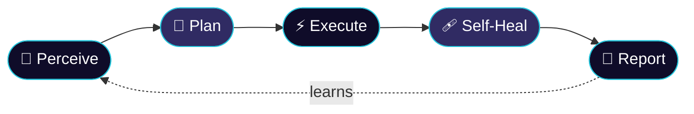

<div align="center">


<a href="https://github.com/unaltugrul">
  
</a>

<br/>

[](https://www.linkedin.com/in/unaltugrulbulut)
[](https://stackoverflow.com/users/17923186/ünaltuğrul-bulut)
[](mailto:unaltugrulbulut@gmail.com)

</div>

---

## `> status`

```text
┌─────────────────────────────────────────────────────┐
│  UNIT        : Ünaltuğrul Bulut                     │
│  ROLE        : Autonomous Test Engineer             │
│  LOCATION    : Türkiye 🇹🇷                           │
│  STATE       : ● ONLINE                             │
│  DIRECTIVE   : Make quality run itself              │
│  LIMITS      : None detected                        │
└─────────────────────────────────────────────────────┘
```

I build quality systems that don't wait for instructions. They study a product, decide what matters, attack it from every angle, repair themselves when the ground shifts, and report back with evidence instead of opinions.

Manual checking is the past. **Quality that thinks, adapts and acts on its own is the standard I build to.**

---

## `> autonomy.loop`

Every system I design runs the same relentless cycle:



| Phase | What happens |
|:------|:-------------|
| 🔭 **Perceive** | Reads the product the way a user, an attacker and an auditor would. Maps every surface, flow and risk. |
| 🧠 **Plan** | Decides *what* deserves testing, in *what order*, at *what depth*. Priority follows risk, never habit. |
| ⚡ **Execute** | Runs at machine speed, in parallel, across web, mobile and API, on every change, at any hour. |
| 🩹 **Self-Heal** | When something shifts, it adapts and recovers instead of breaking and waiting for a human. |
| 📡 **Report** | Delivers clear, evidence-backed verdicts that tell teams exactly what is safe to ship. |

---

## `> capabilities`

<div align="center">

| 🌐 Web | 📱 Mobile | 🔌 API |
|:------:|:---------:|:------:|
| Every journey, every browser, every edge case | Every device, every screen, every gesture | Every contract, every response, every failure mode |

| 🗄️ Data | ⚙️ Pipelines | 📈 Performance |
|:-------:|:------------:|:--------------:|
| Integrity verified at the source | Quality gates woven into every release | Pushed past the limit before users ever find it |

</div>

> **If it exists, it can be tested. If it can be tested, it can be automated. If it can be automated, it can be autonomous.**

---

## `> operating.principles`

- 🎯 **Risk first.** Test what could hurt the most, not what is easiest to reach.
- 🗣️ **Readable by everyone.** Tests that a product owner, a developer and a machine all understand the same way.
- 🔁 **Zero trust in luck.** A green result is only real if it is repeatable, every time.
- 🧬 **Built to evolve.** Systems designed to grow smarter with every run, not older.
- 🚀 **Speed is a feature.** Fast feedback is what turns quality from a gate into an accelerator.

---

## `> live.telemetry`

<div align="center">


</div>

---

## `> open.channel`

Building something that has to work the first time, every time? Let's talk.

- 📧 **Email:** [unaltugrulbulut@gmail.com](mailto:unaltugrulbulut@gmail.com)
- 💼 **LinkedIn:** [linkedin.com/in/unaltugrulbulut](https://www.linkedin.com/in/unaltugrulbulut)
- 💬 **Stack Overflow:** [stackoverflow.com/users/17923186](https://stackoverflow.com/users/17923186/ünaltuğrul-bulut)

<div align="center">

<br/>


</div>
